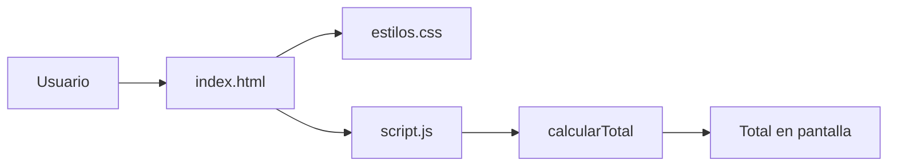

# Tienda TECSUP


Pagina web de una tienda sencilla que lista productos con su precio y
cantidad, y muestra el total de la compra en soles. Pensada para
estudiantes que practican HTML, CSS, JavaScript y el flujo de Issues y
Pull Requests en GitHub.

## Tabla de contenidos

- [Instalacion](#instalacion)
- [Uso](#uso)
- [Estado de las funciones](#estado-de-las-funciones)
- [Hoja de ruta](#hoja-de-ruta)
- [Arquitectura](#arquitectura)
- [Contribucion](#contribucion)
- [Soporte](#soporte)
- [Licencia](#licencia)
- [Autor](#autor)

## Instalacion

**Requisitos:** solo un navegador web moderno. No hay dependencias que instalar.

Clona el repositorio y entra a la carpeta:

```bash
git clone https://github.com/juliovelasquez-tecsup/tienda.git
cd tienda
```

## Uso

1. Abre el archivo `index.html` en tu navegador.
2. Revisa la tabla de productos.
3. Mira la ultima linea: muestra el total de la compra.

La pagina lista estos productos:

| Producto | Precio (S/) | Cantidad |
|:---------|------------:|:--------:|
| Polo TECSUP | 25.00 | 2 |
| Taza TECSUP | 18.00 | 1 |

Resultado esperado: `Total: S/ 68.00`.

La tabla se define en `index.html`:

```html
<table>
  <tr><th>Producto</th><th>Precio</th><th>Cantidad</th></tr>
  <tr><td>Polo TECSUP</td><td>S/ 25.00</td><td>2</td></tr>
  <tr><td>Taza TECSUP</td><td>S/ 18.00</td><td>1</td></tr>
</table>
<p id="total">Total: S/ 0.00</p>
```

Y el total lo escribe `script.js`:

```js
document.getElementById("total").textContent =
  "Total: S/ " + calcularTotal(productos).toFixed(2);
```

## Estado de las funciones

| Funcion | Estado | Prioridad |
|:--------|:------:|----------:|
| Mostrar productos en una tabla | Listo | Alta |
| Calcular el total de la compra | Con error | Alta |
| Cargar los estilos del curso | Con error | Media |
| Agregar y quitar productos | Pendiente | Baja |

### Problemas conocidos

- **Total incorrecto:** la pagina muestra `S/ 43.00` en lugar de
  `S/ 68.00`, porque `calcularTotal` suma el precio sin multiplicarlo
  por la cantidad.
- **Sin estilos:** `index.html` enlaza `estilo.css`, pero el archivo se
  llama `estilos.css`.

Ambos son parte de la practica del Laboratorio 03 y se reportan como Issues.

## Hoja de ruta

- [x] Estructura de la pagina en HTML
- [x] Estilos en `estilos.css`
- [x] Calculo del total en `script.js`
- [ ] Corregir el calculo del total (considerar la cantidad)
- [ ] Corregir el nombre de la hoja de estilos en `index.html`
- [ ] Agregar y quitar productos
- [ ] Guardar el carrito con localStorage

## Arquitectura

El navegador carga `index.html`, que usa una hoja de estilos y un script.
El script calcula el total y lo escribe en la pagina.



La funcion `calcularTotal` recorre la lista de productos:

```js
function calcularTotal(lista) {
  let total = 0;
  for (const producto of lista) {
    total = total + producto.precio;
  }
  return total;
}
```

## Contribucion

Las contribuciones son bienvenidas. Si encuentras un error, reportalo con
un Issue y propone la correccion con un Pull Request.

## Soporte

Si tienes dudas o encuentras un problema, abre un Issue en la pestana
**Issues** de este repositorio.

## Licencia

Este repositorio todavia no incluye un archivo de licencia.

## Autor

Hecho por **TU NOMBRE** - [GitHub](https://github.com/juliovelasquez-tecsup)

Fork del proyecto original de [diogles/tienda](https://github.com/diogles/tienda).